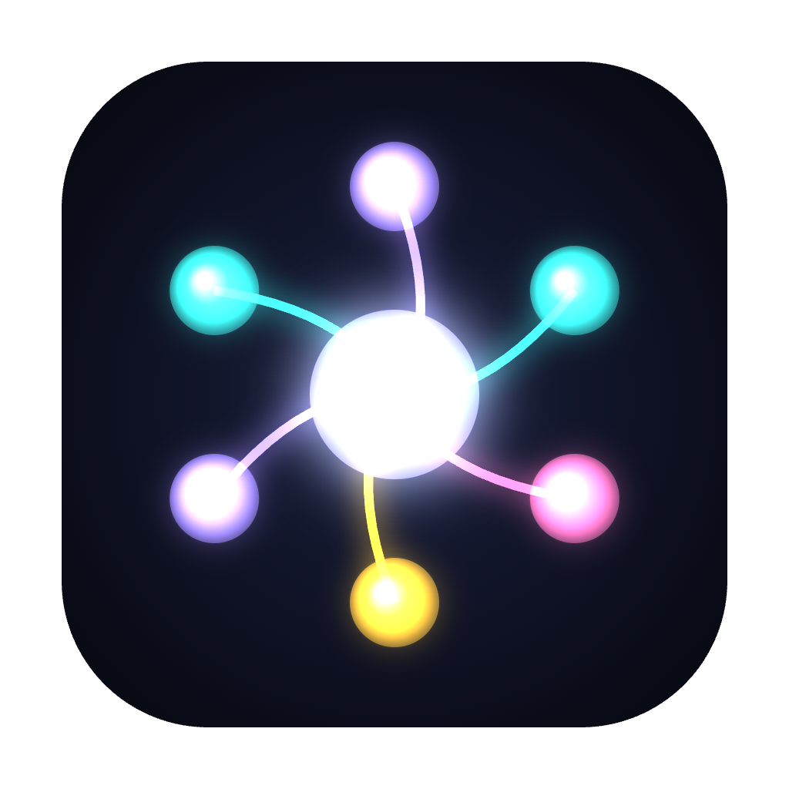
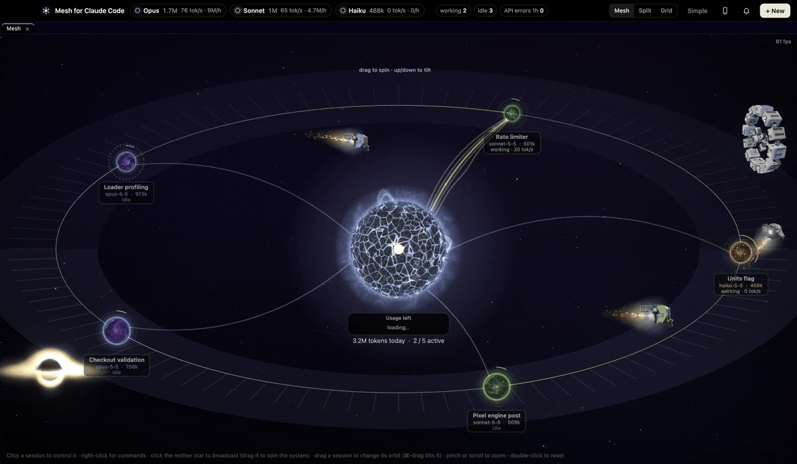
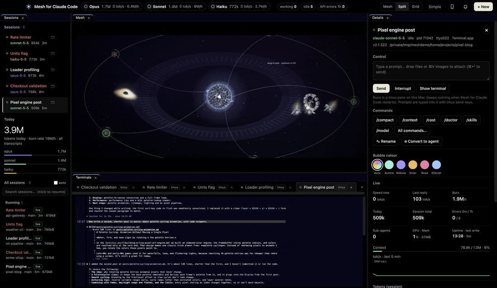
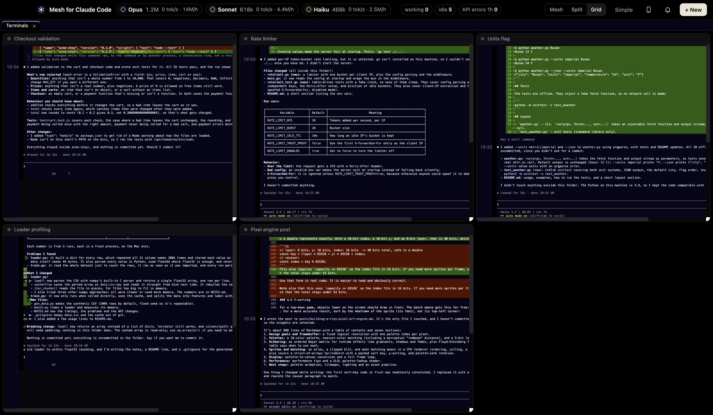
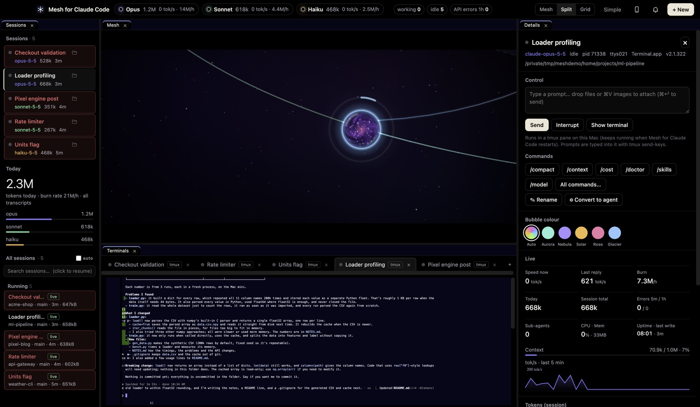
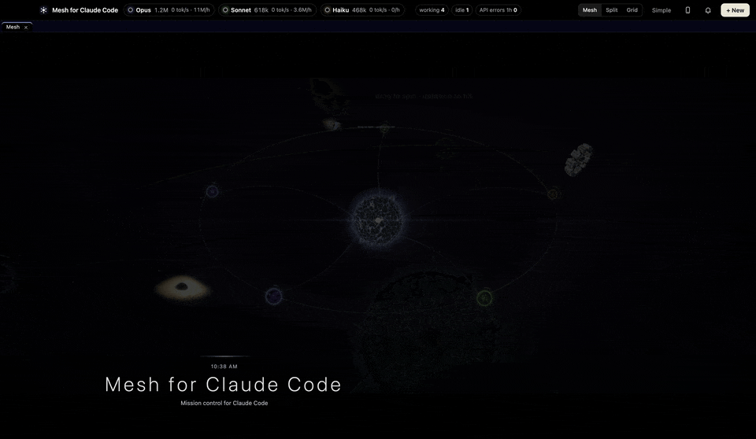

<div align="center">



# Mesh for Claude Code

**Mission control for every Claude Code session you run.**

See all of them orbiting one living star: who is working, who is stuck waiting for you, how fast they burn tokens and how much of your plan is left. Drive any of them from one window, or from your phone.

[](https://github.com/codingintheusa0402/mesh-for-claude-code/stargazers)
[](https://github.com/codingintheusa0402/mesh-for-claude-code/releases/latest)
[](https://github.com/codingintheusa0402/mesh-for-claude-code/releases)
[](https://github.com/codingintheusa0402/mesh-for-claude-code/actions/workflows/build.yml)
[](LICENSE)

**[⬇ Download for macOS](https://github.com/codingintheusa0402/mesh-for-claude-code/releases/latest)** · **[⬇ Download for Windows](https://github.com/codingintheusa0402/mesh-for-claude-code/releases/latest)** · [Tour](#tour) · [Install](#install) · [Phone](#on-your-phone) · [Build from source](#build-from-source)



</div>

## Why Mesh

Running one Claude Code session is easy. Running five, in five folders, across a long day is not: you lose track of which one finished, which one is waiting on a permission prompt, and which one has been burning tokens for an hour. Mesh puts all of them on one screen.

- **See everything at a glance.** Every session is a glowing orb, coloured by model. Strands to the central star thicken as it works harder. Waiting sessions are flagged before you'd notice.
- **Talk to any session from one place.** Send prompts, interrupt, run `/compact`, `/model` or any slash command and your own skills, rename, resume. No hunting through terminal tabs.
- **Know what it costs, live.** Tokens per second, burn rate, today's total per model, context fill, and the same plan limits `/usage` shows, with reset times.
- **Real terminals inside.** xterm.js tabs with Split and Grid views. On macOS sessions live in tmux, so they keep running when the app restarts.
- **Every past session, one click away.** Search everything `claude --resume` knows and reopen it in a terminal.
- **From your phone.** A private, pairing-key-protected web app shows the same live mesh and controls on your iPhone over Wi-Fi or Tailscale.
- **It's fun to leave open.** Probes tidy the system, a black hole eats stale sessions on request, and an idle screen saver plays short films starring your sessions.
- **Local and private.** It reads your own `~/.claude` folder. No account, no telemetry, nothing uploaded.

<a id="tour"></a>
## Tour

| Talk to a session from its panel | Every terminal at once (Grid) |
|---|---|
|  |  |
| **Split view: mesh, terminal and live stats** | **Idle? The screen saver starts a film** |
|  |  |

<a id="install"></a>
## Install

You need [Claude Code](https://docs.claude.com/en/docs/claude-code/overview) installed and logged in. Mesh finds the sessions it runs.

### macOS (Apple Silicon or Intel)

1. Download the `.dmg` for your Mac from the **[latest release](https://github.com/codingintheusa0402/mesh-for-claude-code/releases/latest)** (`arm64` = Apple Silicon, `x64` = Intel) and drag the app to Applications.
2. The app isn't notarized yet, so macOS blocks the first launch. Either run this once in Terminal:
   ```bash
   xattr -dr com.apple.quarantine "/Applications/Mesh for Claude Code.app"
   ```
   or open the app once, then go to **System Settings → Privacy & Security** and click **Open Anyway**.
3. Recommended: `brew install tmux`. Sessions you start from Mesh then live in tmux and survive app restarts and updates.

### Windows 10 / 11 (x64)

1. Install Claude Code for Windows if you haven't: `irm https://claude.ai/install.ps1 | iex` in PowerShell, then run `claude` once to log in.
2. Download `Mesh-for-Claude-Code-Setup-<version>-x64.exe` from the **[latest release](https://github.com/codingintheusa0402/mesh-for-claude-code/releases/latest)** and run it. The installer isn't code-signed yet, so SmartScreen may ask: **More info → Run anyway**.
3. Sessions you start with **+ New** open in Mesh's own terminals (PowerShell). Claude Code sessions you start elsewhere show up in the mesh too.

### What works where

| | macOS | Windows |
|---|:---:|:---:|
| Live mesh, stats, per-model spend, plan usage | ✅ | ✅ |
| Built-in terminals, prompts, slash commands, rename, resume | ✅ | ✅ |
| Phone web app | ✅ | ✅ |
| Sessions keep running across app restarts (tmux) | ✅ | — |
| Control sessions running in Terminal.app | ✅ | — |
| Native iPhone app (build it yourself) | ✅ | — |

Every push is built and launched on macOS (Apple Silicon and Intel) and Windows in [CI](https://github.com/codingintheusa0402/mesh-for-claude-code/actions/workflows/build.yml) before a release.

<a id="build-from-source"></a>
### Build from source

```bash
git clone https://github.com/codingintheusa0402/mesh-for-claude-code.git
cd mesh-for-claude-code
npm install
npm start                      # run it
npx electron-builder --mac --dir   # or --win nsis: build an app / installer into dist/
```

On macOS, `bash install.sh` builds, signs with a local identity if you have one, and installs to `/Applications`.

<a id="on-your-phone"></a>
## On your phone

1. In Mesh click **📱** in the header and turn on **Allow phone access**.
2. Scan the QR code with your phone. Use Wi-Fi on the same network, or [Tailscale](https://tailscale.com) from anywhere.
3. Add it to your home screen. It opens full screen, with pinch-to-zoom, drag-to-orbit, prompts, slash commands and a live terminal.

Phone access is **off by default**. Every request needs the private pairing key in the QR code, and **New pairing key** cuts off every phone paired before. It is never exposed to the internet.

## Privacy

- Mesh reads your local `~/.claude` folder: live session files and transcripts. That is where every number comes from.
- The only network request it makes on its own is the plan-usage check Claude Code's `/usage` makes, with your existing Claude Code login. The token is read at request time and never stored or logged.
- No analytics, no telemetry, no account.

## Love it? ⭐

If Mesh makes your Claude Code days calmer, **[give it a star](https://github.com/codingintheusa0402/mesh-for-claude-code/stargazers)**. It helps other people find it. Bugs and ideas go to [Issues](https://github.com/codingintheusa0402/mesh-for-claude-code/issues), and pull requests are welcome.

[](https://star-history.com/#codingintheusa0402/mesh-for-claude-code&Date)

---

# Reference

The rest of this page is the detailed manual.

## Name it whatever you like

The app's name lives in one setting, used everywhere it appears (window title, menus, the app bundle, the phone page, the iPhone app, installers, logs). The default is **Mesh for Claude Code**.

- Quick: `MESH_NAME="SpongeBob Mesh" npm start`
- Permanent: copy `mesh.local.example.json` to `mesh.local.json` (gitignored) and set `name`, `appId`, `dataDir`, `signId`, `tmuxSession`, `serverHosts`. `bash install.sh` then builds and installs `/Applications/SpongeBob Mesh.app`.
- iPhone app: put `MESH_NAME`, `MESH_BUNDLE_ID` and `DEVELOPMENT_TEAM` in `ios/Local.xcconfig` (gitignored).

Machine- or team-specific add-ons can go in `local/` (gitignored); `local/main.js` is loaded if present.

**Native iPhone app (optional):** `ios/` is a SwiftUI app built with XcodeGen that wraps the same live mesh in a native view, with a QR-scanner pairing screen and automatic fallback between the Tailscale and Wi-Fi addresses. `brew install xcodegen`, then `bash ios/install.sh` builds and installs it on an iPhone connected by cable (Xcode signed in with your Apple ID; with a free Apple ID, re-run it every 7 days).

## What it does

| Area | Features |
|---|---|
| **Live mesh** | Each session is a bubble whose interior is a swirling nebula with sparks and a beating heart-knot. It is coloured by model: Opus violet/cyan, Sonnet green, Fable red/magenta, Haiku amber. Bubbles darken as the session spends during the day and reset at midnight. |
| **Server sessions** | A session that reaches a server you list in `serverHosts` (mesh.local.json), over ssh/scp/rsync or Tailscale SSH, gets its own orb style and a **⇄ server** tag. |
| **Mother bubble** | A burning star at the centre with a heat-haze ripple. Its layers age from young (blue-white) to old (red-orange) with usage: the **rim** follows the 5-hour session limit, the **body** the weekly limit, and the **core** the month. A **Usage left** card below it shows each limit and when it resets. |
| **Load strands** | Glowing curved strands tie each session to the mother, with light pulses running along them. The harder a session works (smoothed tok/s), the more strands it has (1 → 50), and the older their star colour: young blue-white when light, through gold, to red-orange under heavy load. |
| **Navigation** | Pinch or scroll to zoom (0.65×–2×). Drag empty space to pan (the map extends 40% past the window). Double-click empty space to reset the view. Every session keeps its own slow orbit; new sessions take the widest free gap, and nothing re-slots when others come, go or move. Drag a session to give it a new orbit: farther orbits turn slower, closer ones faster. Double-click a session to release it back to an automatic orbit. Clicking empty space only ripples and never pushes sessions. |
| **Stats** | Header shows per-model spend, tok/s and burn $/h, plus counts of working/idle/attention sessions and API errors. The panel shows speed now and last reply, burn, today, session total, errors, sub-agents, CPU/mem, a context gauge, a 5-minute sparkline, token breakdown, spend by model and an activity log. |
| **Press and hold** | Hold a session bubble (about 0.5 s, without moving) to open a dropdown: the **skills** it used, **slash commands** and **tools** with counts, **what it does** (its latest `/compact` summary rendered as markdown; otherwise its first and latest prompt and latest reply) and the **CLAUDE.md** instructions it runs under. The transcript is parsed incrementally. On iPhone, press and hold opens the same view as a sheet. |
| **Control** | Send prompts, Interrupt (Esc), Focus, Kill. In-app sessions are driven through node-pty; sessions in Terminal.app via AppleScript, matched by tty. Broadcast to many sessions by clicking the mother bubble. |
| **Slash commands** | Right-click a session, or click its ⋯ menu, for all built-in commands plus your own `~/.claude` and project skills/commands. Quick chips: `/compact /context /cost /doctor /skills /model`. Typing `/` in the prompt box autocompletes. `/clear` and `/exit` ask for confirmation. |
| **All sessions** | Lists every past session, the same set `claude --resume` shows, with search. **Click to resume** in an in-app terminal with `--dangerously-skip-permissions`; the folder-trust prompt is answered automatically. An **auto** toggle also shows `claude -p` runs. Older sessions with the same name as a newer one (left by a handoff or session refresh) show **replaced**; per name the current one and one replaced copy are kept, older copies go to the Trash, but only once they are more than 7 days old and their session has ended (never a running or resumed session, see CLAUDE.md). |
| **Archify** | **Archify** in a session's menu opens an interactive architecture diagram of that session's project, made with [Archify](https://github.com/tt-a1i/archify) (Apache-2.0). The first time, Mesh runs `claude -p` in the project folder with a pinned copy of the Archify skill (`~/.mesh/tools/archify-v3.2.0`). The project folder stays read-only; everything goes to `~/.mesh/archify/<project>/`. The window shows live progress, then the diagram, how many commits it is behind, **Regenerate**, **Open in browser** and **Show in Finder**. One run at a time per Mac; a session on the other Mac is mapped there. The diagram runs in its own isolated view. |
| **Rename / agents** | Rename any session: running ones get `/rename`, others get a `custom-title` record. **Convert to agent** runs `claude --bg --resume <id>`. The **Agents** list comes from `claude agents --json`, with attach, logs and stop. |
| **Terminals** | xterm.js terminals with tabs, Split/Grid views and a resizable dock. ⌘V pastes Finder files as escaped paths and screenshots as saved PNG paths; Finder drag-drop also works. |
| **Pixel mode** | ⌘P switches to a lightweight retro renderer: low-res, 30 fps, same features. |
| **Notifications** | Optional macOS notifications when a session finishes, errors or waits for input. |

## Performance

- Rendering is GPU-accelerated 2D canvas, **on demand**: the mesh animates for 3 seconds after something changes (your input, a session arriving or changing state), then holds still and draws nothing. New numbers alone redraw one still frame, at most every 5 seconds. It draws nothing while the window is hidden, minimised, occluded or locked.
- A terminal nobody can see takes its output in 2-second batches, except terminal queries, which go straight through. Session polling drops from every second to every 4 once nothing has changed for 20 seconds.
- The backdrop (gradients and stars) is pre-rendered, so each frame is one blit plus about 45 live twinkling stars. Orb textures, the mother's star texture and glow sprites are generated once and cached. Sparks are batched into 4 fills per orb. Nothing uses `shadowBlur`.
- The header, sidebars, buttons and chips don't use `backdrop-filter`: they never overlap the canvas, so the blur was invisible but was recomputed every frame. Only cards and menus that float over the mesh keep it.
- The history list re-renders only when something visible changes.
- Measured on an M6 Mac mini with about 14 sessions listed, all helper processes combined, plain process CPU time:

  | Version | Idle, mesh showing | Minimised |
  |---|---|---|
  | Before | 42% | 4.2% |
  | Now | 3.9% | 3.4 to 4% |

## Updates

Mesh updates itself. `install.sh` installs in place and leaves `update.json` in the app's data folder; the running app (`updater.js`) does the rest:

- Mesh checks for an update when install.sh writes `update.json` (file watch, 60 s fallback). `running.json` always names the live process; a run that ended without a clean quit (crash, force quit) is logged to `update.log` and `exits.jsonl`.
- **UI only:** the window reloads in place after 30 quiet seconds. Window position, panels, the selected session, the active tab, scroll, an unsent prompt and terminal contents all stay.
- **Anything else:** Mesh restarts itself once you've been away for 10 minutes, then puts the view back.
- **Never** while you're typing here, on the other Mac's mirror or on the phone, or while a session is waiting for you.
- **Claude sessions keep running:** they live in a detached tmux session (`mesh`), so a restart only reconnects to them. A session that was started in the app before this moves to tmux the next time it reopens. Plain shell tabs are reopened in the same folder.
- **Rollback:** the replaced version is kept in `prev/`. The "Updated to" note has a Roll back button, and if a new version doesn't come up within 60 seconds the previous one is put back by itself.

## Data sources (all local, read-only except where noted)

- `~/.claude/sessions/<pid>.json`: live sessions with name, status busy/idle, cwd and kind.
- `~/.claude/projects/<enc-cwd>/<sid>.jsonl`, plus `subagents/`: per-message model and token usage. Spend is computed at list price per token type (`PRICES` in `collector.js`). Messages repeated per content block are de-duplicated by `message.id`.
- **Plan usage**: the same request `/usage` makes (`GET api.anthropic.com/api/oauth/usage`), using the Claude Code login read from the macOS keychain at request time. The token is never stored or logged.
  - Fallback: `~/.claude/state/mesh-statusline.json`, which a one-line addition to the user's status-line script saves.
- The weekly peaks behind the monthly estimate are saved in `~/Library/Application Support/<data folder>/weekly-usage.json` (the data folder is `dataDir` in mesh.local.json, default the app's name). The history-list cache is saved in `history-cache.json` in the same folder.
- **Writes**:
  - Renaming a session that isn't running appends a `custom-title` line to its transcript, the same record `/rename` writes.
  - Dragged orbits are saved in localStorage.

## Project layout

```
main.js        Electron main: window, node-pty terminals, AppleScript control, history scan,
               rename, background agents, plan-usage fetch, telemetry loop (1 s)
collector.js   Session registry + incremental transcript tailing → spend/speed/health snapshot
hermes-sessions.js  Hermes Agent sessions in tmux panes: pane ↔ Hermes session, status from its hook, numbers from state.db
session-refresh.js  Session refresh: handoff → fresh session → verification → swap, nightly and on demand
preload.js     window.api bridge (contextIsolation)
mesh-name.js   The app's name / bundle id / data folder: MESH_NAME → mesh.local.json → defaults
phone-server.js  iPhone web-app server: static files + token-protected JSON/SSE API (off by default)
phone/         iPhone home-screen app (index.html, phone.js, phone.css) — reuses the renderer engine
ios/           Native iPhone app (SwiftUI + WKWebView, XcodeGen project.yml, Mesh.xcconfig + your Local.xcconfig)
renderer/
  index.html   Layout + script order
  app.js       Header, session list, detail panel, terminals, views, modals, notifications
  mesh.js      Canvas engine: camera (zoom/pan), backdrop, input, links/fx, frame loop
  mother.js    Mother star: star-ageing colour model, heat-haze rendering, usage card
  bubbles.js   Orbits (Kepler-ish, stable per session), drag-to-orbit, load strands
  organism.js  Session "living universe" bubbles (nebula, fibres, sparks, heart-knot, glass rim)
  pixel.js     Pixel-mode renderer
  commands.js  Slash-command menu, quick chips, "/" autocomplete
  history.js   All-sessions list, resume, rename, convert-to-agent, agents list
  style.css    Glass UI skin + pixel skin
build/         App icon (mkicon.js generates icon.icns)
docs/          README screenshots
install.sh     Build → sign → install to /Applications → relaunch
scripts/       builder-config.js: electron-builder config with your name and bundle id
local/         (gitignored) your own add-ons, loaded if present
```

## Build & install details

```bash
npm install            # Electron 44 + node-pty (allow its install script)
npx electron-rebuild -f -w node-pty
npm start              # run from source
bash install.sh        # build, sign, install to /Applications, relaunch
```

`install.sh` signs with a local self-signed identity named by `signId` in mesh.local.json (default **"Mesh Local Signing"**) if it is in the login keychain. A stable signature means macOS remembers file-access permissions (and a one-time Full Disk Access grant) across rebuilds. Without the identity it falls back to ad-hoc signing.

Updates are written **in place** into `/Applications/<name>.app` (deleting and re-copying the bundle made the Dock drop a pinned icon).

⚠ **Reinstalling quits the app, and that ends every session running in its terminals.** Resume them with one click from **All sessions**.

## Debugging

| Env var | Effect |
|---|---|
| `MESH_DEBUG=1` | Pipe renderer console to stdout; enables `window.api.debugShot(path)` |
| `MESH_SHOT=/path.png` (+ `MESH_SHOT_DELAY=ms`, `MESH_SHOT_QUIT=1`) | Capture the window after it settles |
| `MESH_EVAL='js'` | Run JS in the renderer 3 s after load |
| `MESH_FSGUARD_STUCK=/dir[:/dir]` | QA: treat these protected folders as stuck (macOS) to test the folder guard; `MESH_NO_FSGUARD=1` turns the guard off |

Notes:
- Don't run two instances at once.
- The dev window opens under the pointer, so real scrolling can change its zoom. Stub `viz.wheelZoom` in `MESH_EVAL` for zoom tests.

## Keyboard

⌘1/2/3 Mesh/Split/Grid · ⌘T new session · ⌘B broadcast · ⌘P pixel mode · ⌘4–9 switch terminal tabs


- **Claude or Ollama.** New session → Runs on: Claude, or an open model through [Ollama](https://ollama.com) (local, or cloud after `ollama signin`). It is the same Claude Code in the same terminal, started with `ollama launch claude`; Remote Control stays off for these sessions. To move a running session, right-click it and choose Switch to Ollama… or Switch to Claude: it ends and resumes as the same conversation, and stays on that engine when resumed later. Scripts it starts in its shell follow it. New session also offers Hermes Agent (see below). Every engine switch is logged with who made it in `engine-switches.jsonl` in the app's data folder; `/api/resume` refuses an engine change that doesn't say where it came from.

- **Hermes Agent sessions.** New session → Hermes Agent starts `hermes chat` in a tmux pane, under a name of its own, so it survives quiet updates and app restarts like a Claude session. It is a full session: bubble, live terminal, image paste and drop, the other Mac's mirror, the phone page, rename (sent as `/title`), project card, token counts (Token usage reads Hermes' own `~/.hermes/state.db`), reopen after restart (it reopens in Hermes, never in Claude). Its status (working / waiting / idle) comes from a Hermes shell hook that writes `~/.hermes/mesh/<session>.json`; tokens, model and the recent log come from `state.db`. Text sent from the phone or the other Mac waits until the session's input box is empty, so it never mixes into something you were typing. A Mac without the Ollama app starts Hermes sessions on the other Mac and shows them as a mirror.
- **Session refresh.** App menu ▸ Session Refresh… (or a session's menu ▸ Refresh now). Long sessions get slow and costly, so a refresh swaps a session for a fresh one with the same name, folder, engine and model: the old one writes a complete HANDOFF.md in one canonical place, `~/.mesh/handoffs/<name>/HANDOFF.md` (spaces become `_`; a handoff found anywhere else moves there and leaves a one-line pointer, except in Hermes-run projects), the new one reads it in full (the handoff wins over its memory files) and loads it and must answer 3–5 questions about its own project correctly (graded on the session's own engine family) before it takes over; its `/loop` is re-armed and the next tick watched; colour, group, orbit and project card follow it; the old transcript is archived for 7 days in `~/.mesh/session-archive/`. Nightly at a set time (per session: nightly, weekends, Sundays, never), and also when a session's context passes ~60 % (Hermes sessions: read from Hermes' own status bar) or its tokens today are far above its normal. Never while a session works, waits for you, or still has something running: sub-agents, background tasks, Claude Bash tasks, Hermes background processes, or tmux jobs in its folder; or its loop ticks within 5 minutes. A blocked nightly refresh is retried every 30 minutes until 07:00, then the next night. Only the context trigger (~60 %) refreshes anyway: the running jobs are listed in the handoff for the new session to take over, nothing is killed, and the old session stays open until its jobs finish. Text you typed but didn't send is saved (`UNSENT-INPUT.txt` next to the handoff), cleared, and typed back into the new session's box without sending; if that fails it stays in the file and you're alerted. Every step is journaled (`<userData>/refresh-journal.json`): if Mesh dies mid-refresh, the next start rolls it back (before the new session took over) or finishes it (after). Any failure keeps the old session and alerts. Log: `~/.mesh/session-refresh.log`. Paths, per-session defaults and extra rules for named projects can be set in `local/session-refresh.json`.
- **Which agent runs a project.** New session → "Project … runs on: Claude Code / Hermes" sets it per project, in `<project>/.mesh.json` (`{"orchestrator": "hermes"}`), so both Macs and the project's own scripts read the same answer. In a Hermes project, Mesh opens Hermes even when asked for a Claude session, and its project card is written by an Ollama model instead of Claude Haiku. Changes are logged in `engine-switches.jsonl`.
- **Folders across Macs.** A session on the other Mac has a folder button too: it opens the same folder here if this Mac has it, otherwise a viewing copy in iCloud Drive under `Mesh Folders/<machine>/`. Set `"folderMirror": true` in `mesh.local.json` to keep those copies (one-way, every 15 minutes, no repos, secrets, databases, logs or files over 25 MB). Working folders never move into iCloud.
- **Sub-sessions and cleanup.** Unnamed sessions and a script's `claude -p` runs fold under the session that works in the same project. Click the black hole, or Clean up in Simple view, to end every session unused for 24 or 48+ hours at once; each can be reopened from History. In the mesh a sub-session is a small satellite of its main session: point at it for its name, click it to open it. A session another session started (found from the process tree) always belongs to that session.
- **Token usage.** Click the mother star, then Token usage: today, this week and this month, sessions ranked by tokens, 30 days by project, and a split by model. If Ollama is signed in, it also shows what's left on that account, when it resets and the pace, read from Ollama; tokens left is an estimate from the cost per token so far. Ollama's tokens don't count toward the Claude weekly-limit pace. Totals come from Claude Code's logs and stay in a local SQLite file (counts and session names only), so they outlive log cleanup. Simple view shows a usage pill, and each card a ring for its share of the day. Optional `usageAlert` in `mesh.local.json` (`host`, `cmd` with `{title}` and `{body}`) runs a command on one machine when a session passes 30% of the day or the day passes 2x the 7-day average. The totals cover both Macs as one number; if the other Mac is offline the panel says so and shows when its share was last read.

## License

[MIT](LICENSE). Mesh for Claude Code is an independent project and is not affiliated with or endorsed by Anthropic. Claude and Claude Code are trademarks of Anthropic.
