<div align="center">

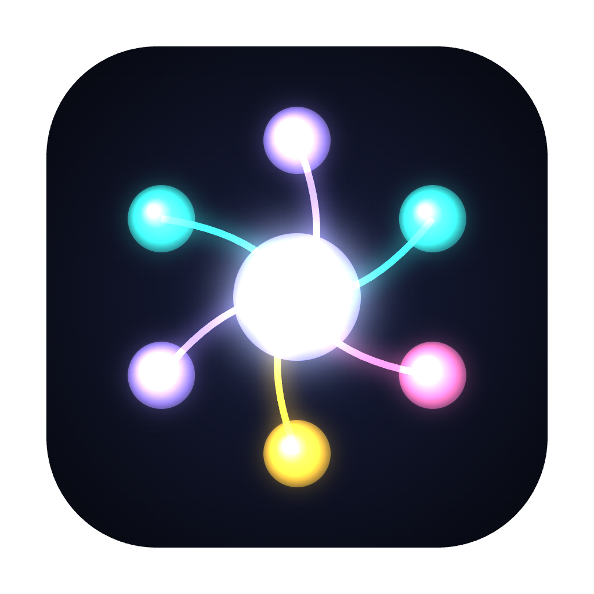

# Mesh for Claude Code

**Mission control for every Claude Code session you run.**

See all of them orbiting one living star: who is working, who is stuck waiting for you, how fast they burn tokens and how much of your plan is left. Drive any of them from one window, or from your phone.

[](https://github.com/codingintheusa0402/mesh-for-claude-code/stargazers)
[](https://github.com/codingintheusa0402/mesh-for-claude-code/releases/latest)
[](https://github.com/codingintheusa0402/mesh-for-claude-code/releases)
[](https://github.com/codingintheusa0402/mesh-for-claude-code/actions/workflows/build.yml)
[](LICENSE)

**[⬇ Download for macOS](https://github.com/codingintheusa0402/mesh-for-claude-code/releases/latest)** · **[⬇ Download for Windows](https://github.com/codingintheusa0402/mesh-for-claude-code/releases/latest)** · [Tour](#tour) · [Chat theme](#chat-theme) · [Install](#install) · [Phone](#on-your-phone) · [Build from source](#build-from-source)

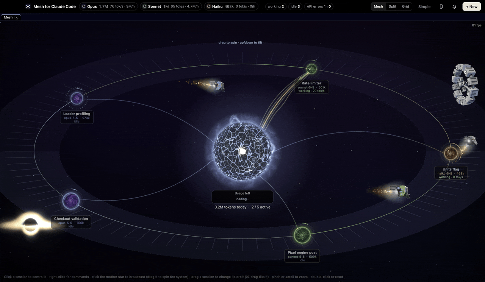

</div>

## Why Mesh

Running one Claude Code session is easy. Running five, in five folders, across a long day is not: you lose track of which one finished, which one is waiting on a permission prompt, and which one has been burning tokens for an hour. Mesh puts all of them on one screen.

- **See everything at a glance.** Every session is a glowing orb, coloured by model. Strands to the central star thicken as it works harder. Waiting sessions are flagged before you'd notice.
- **Talk to any session from one place.** Send prompts, interrupt, run `/compact`, `/model` or any slash command and your own skills, rename, resume. No hunting through terminal tabs.
- **Know what it costs, live.** Tokens per second, burn rate, today's total per model, context fill, and the same plan limits `/usage` shows, with reset times.
- **Real terminals inside.** xterm.js tabs with Split and Grid views. On macOS sessions live in tmux, so they keep running when the app restarts.
- **Every past session, one click away.** Search everything `claude --resume` knows and reopen it in a terminal.
- **See the code, too.** A Code map shows any session's project as an interactive graph, and one view shows all your projects together.
- **Two Macs, one mesh.** Pair a second Mac and both show every session; a session always runs on its own Mac.
- **Looks like a messenger, if you want.** An optional [chat theme](#chat-theme) (Light, Dark or follows macOS) turns the session list into a chat list and each session into a chat room, with session pictures, on the Mac and on your phone, and lets you tear rooms off into windows of their own.
- **From your phone.** A private, pairing-key-protected web app shows the same live mesh and controls on your iPhone over Wi-Fi or Tailscale.
- **It's fun to leave open.** Probes tidy the system, a black hole eats stale sessions on request, and an idle screen saver (off by default, View ▸ Mesh) plays short films starring your sessions.
- **Local and private.** It reads your own `~/.claude` folder. No account, no telemetry, nothing uploaded.

<a id="tour"></a>
## Tour

| Talk to a session from its panel | Every terminal at once (Grid) |
|---|---|
| 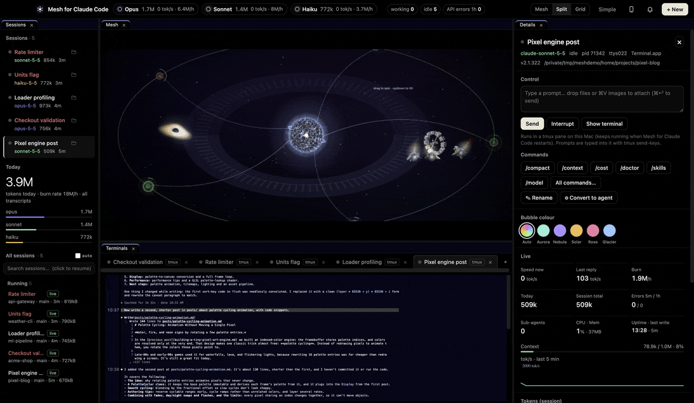 | 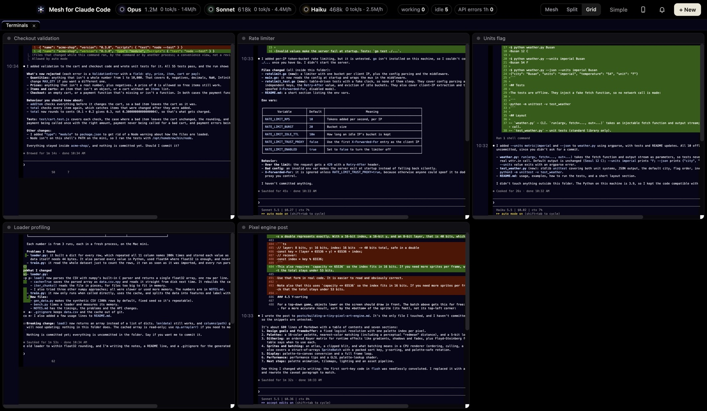 |
| **Split view: mesh, terminal and live stats** | **Idle? The screen saver starts a film** |
| 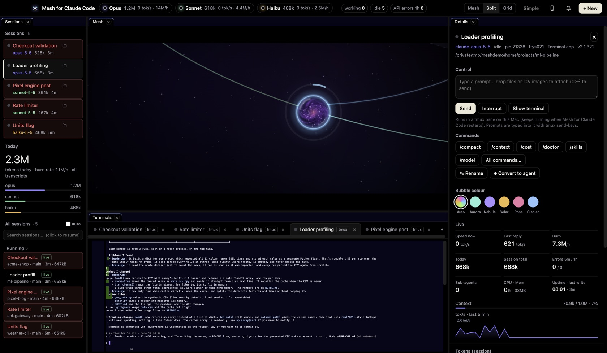 | 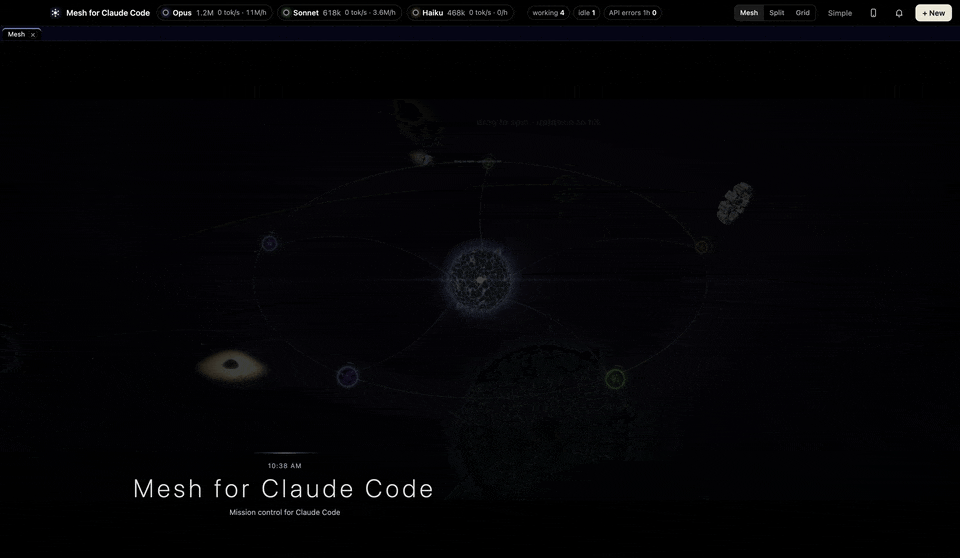 |

<a id="chat-theme"></a>
### Chat theme

Prefer a messenger to a terminal? Turn on the chat theme (**View ▸ Theme**) and every session becomes a chat room: your prompts in yellow, replies with the session's picture, tool calls folded into one grey line each. Light, Dark or Match System.

| Light | Dark |
|---|---|
| 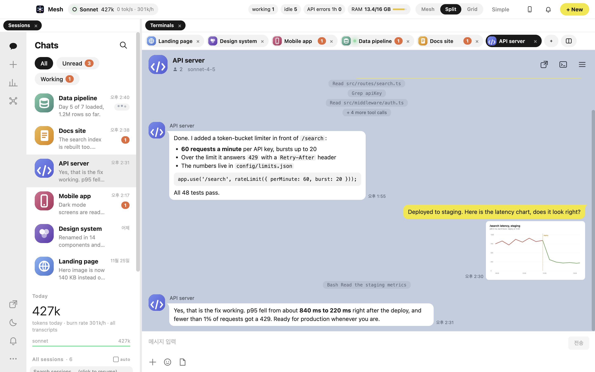 | 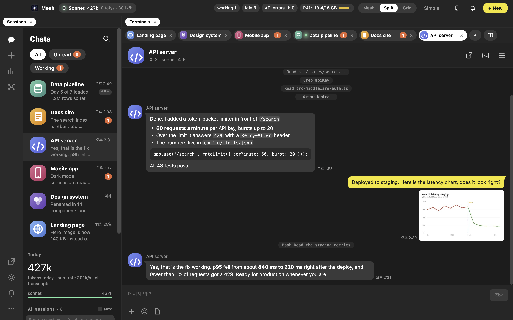 |
| <sub>Chats on the left with unread badges and typing dots; the room renders markdown, code and pasted pictures.</sub> | <sub>Dark mode, or let it follow macOS.</sub> |

<p align="center">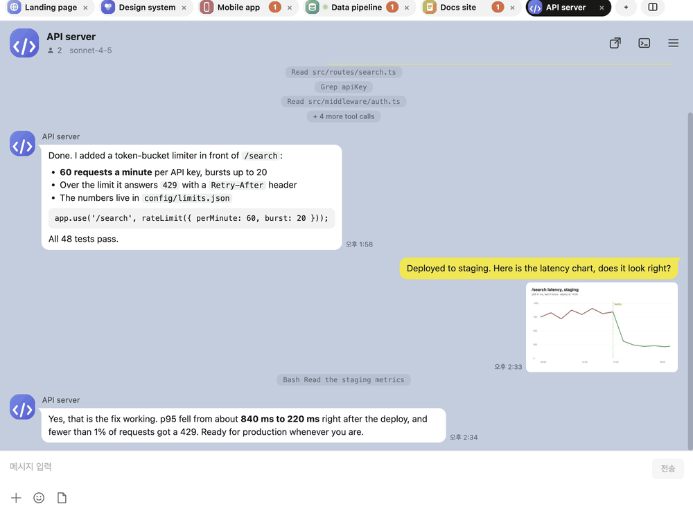<br><sub>Type, send, watch it work: "…" while the session thinks, its tool calls as they happen, then the reply.</sub></p>

| A room in its own window | The same room on your iPhone |
|---|---|
| 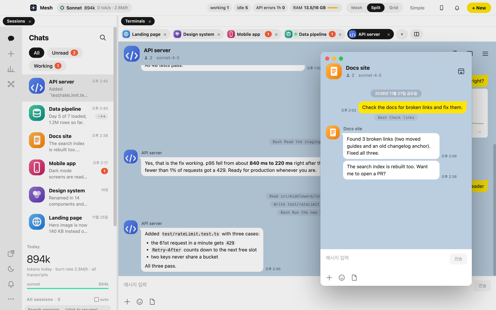 | 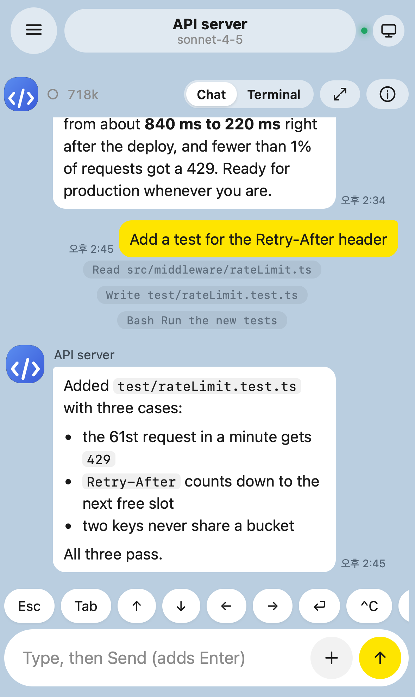 |
| <sub>Drag a tab out of the window, or double-click a chat, to give it a window of its own.</sub> | <sub>The phone page has the same room, with a Chat / Terminal switch.</sub> |

<a id="install"></a>
## Install

You need [Claude Code](https://docs.claude.com/en/docs/claude-code/overview) installed and logged in. Mesh finds the sessions it runs.

### macOS (Apple Silicon or Intel)

1. Download the `.dmg` for your Mac from the **[latest release](https://github.com/codingintheusa0402/mesh-for-claude-code/releases/latest)** (`arm64` = Apple Silicon, `x64` = Intel) and drag the app to Applications.
2. The app isn't notarized yet, so macOS blocks the first launch. Either run this once in Terminal:
   ```bash
   xattr -dr com.apple.quarantine "/Applications/Mesh for Claude Code.app"
   ```
   or open the app once, then go to **System Settings → Privacy & Security** and click **Open Anyway**.
3. Recommended: `brew install tmux`. Sessions you start from Mesh then live in tmux and survive app restarts and updates.

### Windows 10 / 11 (x64)

1. Install Claude Code for Windows if you haven't: `irm https://claude.ai/install.ps1 | iex` in PowerShell, then run `claude` once to log in.
2. Download `Mesh-for-Claude-Code-Setup-<version>-x64.exe` from the **[latest release](https://github.com/codingintheusa0402/mesh-for-claude-code/releases/latest)** and run it. The installer isn't code-signed yet, so SmartScreen may ask: **More info → Run anyway**.
3. Sessions you start with **+ New** open in Mesh's own terminals (PowerShell). Claude Code sessions you start elsewhere show up in the mesh too.

### What works where

| | macOS | Windows |
|---|:---:|:---:|
| Live mesh, stats, per-model spend, plan usage | ✅ | ✅ |
| Built-in terminals, prompts, slash commands, rename, resume | ✅ | ✅ |
| Phone web app | ✅ | ✅ |
| Sessions keep running across app restarts (tmux) | ✅ | — |
| Control sessions running in Terminal.app | ✅ | — |
| Native iPhone app (build it yourself) | ✅ | — |

Every push is built and launched on macOS (Apple Silicon and Intel) and Windows in [CI](https://github.com/codingintheusa0402/mesh-for-claude-code/actions/workflows/build.yml) before a release.

<a id="build-from-source"></a>
### Build from source

```bash
git clone https://github.com/codingintheusa0402/mesh-for-claude-code.git
cd mesh-for-claude-code
npm install
npm start                      # run it
npx electron-builder --mac --dir   # or --win nsis: build an app / installer into dist/
```

On macOS, `bash install.sh` builds, signs with a local identity if you have one, and installs to `/Applications`.

<a id="on-your-phone"></a>
## On your phone

1. In Mesh click **📱** in the header and turn on **Allow phone access**.
2. Scan the QR code with your phone. Use Wi-Fi on the same network, or [Tailscale](https://tailscale.com) from anywhere.
3. Add it to your home screen. It opens full screen with a session drawer, prompts, slash commands and a live terminal. It follows your session pictures and has its own theme (Default, Light, Dark or Match System) in the ☰ drawer.

Phone access is **off by default**. Every request needs the private pairing key in the QR code, and **New pairing key** cuts off every phone paired before. It is never exposed to the internet.

## Privacy

- Mesh reads your local `~/.claude` folder: live session files and transcripts. That is where every number comes from.
- The only network request it makes on its own is the plan-usage check Claude Code's `/usage` makes, with your existing Claude Code login. The token is read at request time and never stored or logged.
- No analytics, no telemetry, no account.

## Love it? ⭐

If Mesh makes your Claude Code days calmer, **[give it a star](https://github.com/codingintheusa0402/mesh-for-claude-code/stargazers)**. It helps other people find it. Bugs and ideas go to [Issues](https://github.com/codingintheusa0402/mesh-for-claude-code/issues), and pull requests are welcome.

[](https://star-history.com/#codingintheusa0402/mesh-for-claude-code&Date)

---

# Reference

The rest of this page is the detailed manual.

## Name it whatever you like

The app's name lives in one setting, used everywhere it appears (window title, menus, the app bundle, the phone page, the iPhone app, installers, logs). The default is **Mesh for Claude Code**.

- Quick: `MESH_NAME="SpongeBob Mesh" npm start`
- Permanent: copy `mesh.local.example.json` to `mesh.local.json` (gitignored) and set `name`, `appId`, `dataDir`, `signId`, `tmuxSession`, `serverHosts`, `chatThemeName` (the chat theme's label in View ▸ Theme and the star menu), `sunSession` (which session is the sun; default: the app's name). `bash install.sh` then builds and installs `/Applications/SpongeBob Mesh.app`.
- iPhone app: put `MESH_NAME`, `MESH_BUNDLE_ID` and `DEVELOPMENT_TEAM` in `ios/Local.xcconfig` (gitignored).

Machine- or team-specific add-ons can go in `local/` (gitignored); `local/main.js` is loaded if present.

**Native iPhone app (optional):** `ios/` is a SwiftUI app built with XcodeGen that wraps the same live mesh in a native view, with a QR-scanner pairing screen and automatic fallback between the Tailscale and Wi-Fi addresses. `brew install xcodegen`, then `bash ios/install.sh` builds and installs it on an iPhone connected by cable (Xcode signed in with your Apple ID; with a free Apple ID, re-run it every 7 days).

## What it does

| Area | Features |
|---|---|
| **Live mesh** | Each session is a bubble whose interior is a swirling nebula with sparks and a beating heart-knot. It is coloured by model: Opus violet/cyan, Sonnet green, Fable red/magenta, Haiku amber. Bubbles darken as the session spends during the day and reset at midnight. |
| **Server sessions** | A session that reaches a server you list in `serverHosts` (mesh.local.json), over ssh/scp/rsync or Tailscale SSH, gets its own orb style and a **⇄ server** tag. |
| **Mother bubble** | A burning star at the centre with a heat-haze ripple. Its layers age from young (blue-white) to old (red-orange) with usage: the **rim** follows the 5-hour session limit, the **body** the weekly limit, and the **core** the month. A **Usage left** card below it shows each limit and when it resets. |
| **The Core** | The session that runs the app (named like the app, or `sunSession` in mesh.local.json) is the mother star itself: fixed in the middle, a little larger, with a warm still halo and its name, status, last activity and relays today above it. Click the star to open that session; right-click it for the star menu (Broadcast, Token usage). If several sessions carry that name, the current generation of its handoff lineage is the sun and the others are labelled **duplicate**. It still shows in the session list, the Simple board and Grid like every other session, tagged **Core**. |
| **Relays** | Messages between sessions (Claude Code's SendMessage / cross-session messages, read from the transcripts) are counted per session: **⇄ N** today in the list, the Simple board and on the iPhone. On the mesh each new one is drawn as a beam for 4 s, from the sender to the receiver; the sun's own messages and messages from the app itself start or end at the star. Nothing animates between relays; with Reduce Motion the beams are still lines that fade. |
| **Load strands** | Glowing curved strands tie each session to the mother, with light pulses running along them. The harder a session works (smoothed tok/s), the more strands it has (1 → 50), and the older their star colour: young blue-white when light, through gold, to red-orange under heavy load. |
| **Navigation** | Pinch or scroll to zoom (0.65×–2×). Drag empty space to pan (the map extends 40% past the window). Double-click empty space to reset the view. Every session keeps its own slow orbit; new sessions take the widest free gap, and nothing re-slots when others come, go or move. Drag a session to give it a new orbit: farther orbits turn slower, closer ones faster. Double-click a session to release it back to an automatic orbit. Clicking empty space only ripples and never pushes sessions. |
| **Stats** | Header shows per-model spend, tok/s and burn $/h, plus counts of working/idle/attention sessions and API errors. The panel shows speed now and last reply, burn, today, session total, errors, sub-agents, CPU/mem, a context gauge, a 5-minute sparkline, token breakdown, spend by model and an activity log. |
| **Press and hold** | Hold a session bubble (about 0.5 s, without moving) to open a dropdown: the **skills** it used, **slash commands** and **tools** with counts, **what it does** (its latest `/compact` summary rendered as markdown; otherwise its first and latest prompt and latest reply) and the **CLAUDE.md** instructions it runs under. The transcript is parsed incrementally. On iPhone, press and hold opens the same view as a sheet. |
| **Control** | Send prompts, Interrupt (Esc), Focus, Kill. In-app sessions are driven through node-pty; sessions in Terminal.app via AppleScript, matched by tty. Broadcast to many sessions by clicking the mother bubble. |
| **Slash commands** | Right-click a session, or click its ⋯ menu, for all built-in commands plus your own `~/.claude` and project skills/commands. Quick chips: `/compact /context /cost /doctor /skills /model`. Typing `/` in the prompt box autocompletes. `/clear` and `/exit` ask for confirmation. |
| **All sessions** | Lists every past session, the same set `claude --resume` shows, with search. **Click to resume** in an in-app terminal with `--dangerously-skip-permissions`; the folder-trust prompt is answered automatically. An **auto** toggle also shows `claude -p` runs. Older sessions with the same name as a newer one (left by a handoff or session refresh) show **replaced**; per name the current one and one replaced copy are kept, older copies go to the Trash, but only once they are more than 7 days old and their session has ended (never a running or resumed session, see CLAUDE.md). |
| **Code map** | **Code map** in a session's menu opens an interactive knowledge graph of that session's project: every file, function and module, how they call and import each other, and the main areas (communities), with search and click-through. It is built by [Graphify](https://github.com/Graphify-Labs/graphify) (Apache-2.0): it parses the code locally with tree-sitter (vendored, minified and build files skipped), then groups it into areas and names them with whatever model it finds, such as the Claude Code CLI (only area and symbol names are sent). Usually under a minute. Install it once with `uv tool install graphifyy`. The map is saved in `~/.mesh/codemap/<project>/` (the project folder isn't touched) and rebuilt when the project has newer commits; a project that keeps its own Graphify graph (`graphify install --project`) is shown from there. The window has **Rebuild**, **Report** (key concepts and suggested questions), **Open in browser** and **Show in Finder**. A session on the other Mac is mapped there. **All projects** (the rail's graph icon, or View ▸ Code Map (All Projects), ⌘⇧M) shows every session's project as one picture: each project a hub with its code areas around it, linked where projects really connect (a folder inside another, imports, the same file names, messages between their sessions, one lineage); click a session to open its own map, **‹ All projects** to come back. With two Macs paired, each serves its own sessions and the window merges both: a folder both Macs work in is one hub. **Simple / Detail** in its header switches to a picture of every project's real items and links (each project a cluster of small dots coloured by area, around its hub; at most about 9,000 items and 15,000 links in all, the best-linked first, so the header says "showing N of M items"): hover an item for its name, file and area, click it for its neighbours, double-click a cluster to open that project's map. The choice is remembered. |
| **Rename / agents** | Rename any session: running ones get `/rename`, others get a `custom-title` record. **Convert to agent** runs `claude --bg --resume <id>`. The **Agents** list comes from `claude agents --json`, with attach, logs and stop. |
| **Terminals** | xterm.js terminals with tabs, Split/Grid views and a resizable dock. **Split view:** up to 4 terminals side by side in the Terminals panel: the split button in the tab row (or ⌘\) shows two, ⌘-click a tab or drag it down onto the terminal area to add one, × on a pane's label (or ⌘-click again) takes it out; a tab you click goes into the focused pane. Kept across restarts. ⌘V pastes Finder files as escaped paths and screenshots as saved PNG paths; Finder drag-drop also works. Notes-style editing keys: ⌘Z undo, ⌘←/→ line start/end, ⌘⇧←/→ select to line start/end (then ⌫ deletes it, typing replaces it, ⌘C copies it), ⌘⌫ delete to line start, ⌥←/→ and ⌥⌫ by word. Text colour themes (Dracula by default, Catppuccin Mocha, Tokyo Night, Gruvbox Dark, Nord, Mesh classic) are picked from the mother star's menu; the terminal itself is see-through, so it always has the Mesh background. The font is Apple's SF Mono, loaded from `/System/Library/Fonts` (Menlo if it's missing). |
| **Live panel** | **Window → Live** (one entry; a submenu once you pin more, each named after its session). It follows the selected session; 📌 pins another panel to one session. Header: session, status, model, context used vs the refresh cap as a bar, the current tool or step, time since its last activity and the Chrome it should use. **Browser**: a strip for each logged-in Chrome (up / frozen / down, last health check, restarts today, open tabs per owner, sign-ins), red warnings for a wrong port or account, a tab picker grouped by port then owner (port badge, account, owner, short URL), and the tab's picture: one screenshot every 3 s at most and only while on screen, blurred by default on mail, chat and pages that show passwords, keys or tokens (◐ toggles it), never written to disk. **Code**: the real commands (Claude Code's shell wrapper stripped, paths shortened to `~` / `$SCRATCH`), live output, processes with run time and CPU. **Calls**: one line per call (time · tool · summary), tap to expand, errors in red, an errors-only filter, repeated identical errors folded into one line with a count. The iPhone page has the same view (**◉ Live** in a session's sheet). Configure the Chromes with `liveChrome` in mesh.local.json (see below). It makes no Claude calls. |
| **Chat theme** | Optional. Pick **View ▸ Theme** (or **Theme** in the mother star's menu): **Default**, or the chat theme as **Light**, **Dark** or **Match System** (follows macOS); kept per machine, the two menus stay in sync, and **Default** brings the usual look back unchanged. The whole window takes the messenger look (header, dock tabs, Terminals tabs, the Simple board, Details), the Sessions panel becomes a chat list with a left icon rail, and each session's terminal panel a chat room. A room or the list can also open in a window of its own. See [Chat theme](#chat-theme-light-dark-and-windows-of-their-own) below. The label is `chatThemeName` in mesh.local.json. |
| **Pixel mode** | ⌘P switches to a lightweight retro renderer: low-res, 30 fps, same features. |
| **Notifications** | Optional macOS notifications when a session finishes, errors or waits for input. |

### Chat theme: light, dark and windows of their own

Screenshots: [Chat theme](#chat-theme) in the Tour.

**Look.** Light: white list and header, blue-grey rooms, yellow bubbles for your prompts, white replies with avatar and name. Dark (the messenger's macOS dark mode): a near-black list (#1E1E1E) beside a lighter icon rail, white names with grey previews and times, dark-grey pill filters with the selected one white, a #1C1C1C room with dark-grey replies, yellow bubbles for yours, a dark input bar whose **전송** button turns yellow when there is something to send. In both:

- **Header**: usage, model and status pills as grey pills, the Mesh / Split / Grid switch as pill filters (the selected one filled), **+ New** in yellow; a mode switch that is ON stays red-orange.
- **Sessions panel**: a left icon rail (Chats, New session, Token usage; at the bottom: open the list in its own window, Light / Dark, notifications, the star menu) beside the chat list (rounded-square avatar in the session's colour, bold name, grey latest line, time, red-orange unread badge, typing dots while it works, All / Unread / Working filters, search).
- **Terminals tabs**: one pill per session with its avatar and unread badge; the selected one filled. A plain shell (or a session switched to its real terminal) keeps a dark background for its text colours.
- **Mesh panel**: the orbit keeps its night sky; the Simple board becomes cards with avatar, bold name, host tag, grey model / tokens / age line and the unread badge.
- **Rooms**: paste or drop pictures and files into the room's input box and they become chips sent with your message (a paste in the room is the room's own, not the terminal's; files for a session on the other Mac are uploaded there first). Before a send, leftovers of an old paste (`[Image #n]` tokens, paste-folder paths) in the session's input box are cleared; text a person typed there is never touched. A sent message shows once: its pending bubble is matched to the transcript by text, ignoring spacing, attached paths and image tags. Pictures show as pictures, files as file cards; a yellow **1** beside a message you sent until the session has it in its transcript (the messenger's read count); selected text shows in clear blue, also inside bubbles, lists and code (white on blue in your yellow bubbles).

**Windows of their own.** Everything stays docked in one window until you take something out:

- **A room**: drag its Terminals tab out of the Terminals panel (onto the board, the sidebar, anywhere outside the tab row; inside the row a drag only reorders tabs), double-click the session in the chat list, or click the room header's pop-out button. Several rooms can be open at once, each in its own window. While a room is out, its tab leaves the Terminals row (the session keeps running); clicking the session in the list brings its window to the front.
- **The chat list**: drag the **Sessions** panel tab out of the window, or the rail's pop-out button. In that window a click selects the session in the main window, a double-click opens its room.
- **At most 6 windows** (`MESH_CHATWIN_MAX`): each is its own page process (about 90 MB). Opening another docks the one used longest ago back into the main window.
- **Back**: close the window, or its dock-back button (room header, or the list's rail). Switching to **Default** docks everything.
- Each window remembers its size and place (`chat-windows.json` in the app's data folder, per room and for the list). Errors, hangs and crashes of a window go to `chatwin.log` there; a crashed window reloads.

A detached window (`renderer/chatwin.html`) runs the same chat-theme code as the main window, so the transcript, send, attach, paste and picture paths are the same, sessions on the other Mac included. It gets the snapshot main already makes for the main window (one session for a room), and only while it is visible and not minimised, so a room polls only what a shown docked room polls.

### Session pictures (`avatars` in mesh.local.json)

Click a session's avatar (a Simple-board card, a chat-list row or a room header, detached rooms included) to give it a picture: a grid of every picture and GIF in the pictures folder, **Letter** (back to the initial), **Sync now**, **Show folder** and **Open in Drive** (when the sync reports a cloud folder).

- **Cropped for you.** Each picture becomes a centred square (a 16:9 GIF loses its sides, and with them corner watermarks) at 256 and 512 px, made with `ffmpeg` (Homebrew) and kept in `<dir>/.cache`. GIFs stay animated and play forward then backward, so the loop never jumps back to the first frame.
- **Keyed by the session name**, not its id: a handoff, refresh or new generation keeps the picture. Picks live in one JSON file (`store`), `{ "<name>": { file, t, by } }`; sessions without one keep the initial-letter avatar.
- **Both Macs.** Picks merge by name (last write wins) on every peer poll and are pushed to the paired Mac when made, so a pick shows on the other Mac within seconds; a picture only the other Mac has is fetched once from it (`/api/avatar`).
- **Where it shows**: the Simple board cards (Default and chat theme), the chat list, Terminals tabs, room headers and reply avatars, the Live panel header, the iPhone page (drawer, session list, cards, session header; picked pictures only), and the **orbit view**: rest the pointer on a bubble (about 0.6 s) and its picture pops up above it with the session's name (the Core's picture on the central star); it goes away when the pointer moves off.
- **Filling the folder** is up to you: drop files into `dir`, or sync a folder (for example a shared cloud folder) into `~/.mesh/avatars` yourself. `syncCmd` is a command that mirrors it there (it runs from **Sync now**; run it on a schedule yourself) and writes `<dir>/.sync.json` `{ at, ok, error?, folderUrl? }` for the status line.

```json
"avatars": { "dir": "~/.mesh/avatars", "store": "~/.mesh/avatars.json", "source": "Team pictures", "syncCmd": "python3 ~/bin/pictures_sync.py" }
```

### Live panel: your logged-in Chromes (`liveChrome` in mesh.local.json)

All optional; without it the Browser view lists the DevTools ports from `chromePorts`.

| Key | Meaning |
|---|---|
| `host` | The Mac whose Chromes these are (`hostname -s`); the other Mac and the phone ask that one. |
| `registry` | JSON file `{ "kinds": { "<kind>": { "port", "user_data_dir", "profile", "account", "label" } } }` (kinds `work` / `personal` get blue / green badges). |
| `ledger` | JSON file `{ "<tab id>": { "owner": "<session>" } }` naming each tab's owner. |
| `loginLog` | Log of a login checker with lines like `2026-01-01 10:00:00 mail: signed in`. `loginSites` (regex) picks which to show, `loginKind` which Chrome they belong to. A line `… pending=` marks a finished health check. |
| `portLog` | Log with a `launch <kind>` line per Chrome start (restarts today). |
| `personal` | Regex of session names that belong on the personal Chrome; others belong on work. `infraOwners` (regex): helper tab owners that never count as misplaced. |

## Performance

- Rendering is GPU-accelerated 2D canvas, **on demand**: the mesh animates for 3 seconds after something changes (your input, a session arriving or changing state), then holds still and draws nothing. New numbers alone redraw one still frame, at most every 5 seconds. It draws nothing while the window is hidden, minimised, occluded or locked.
- A terminal nobody can see takes its output in 2-second batches, except terminal queries, which go straight through. Session polling drops from every second to every 4 once nothing has changed for 20 seconds.
- The backdrop (gradients and stars) is pre-rendered, so each frame is one blit plus about 45 live twinkling stars. Orb textures, the mother's star texture and glow sprites are generated once and cached. Sparks are batched into 4 fills per orb. Nothing uses `shadowBlur`.
- The header, sidebars, buttons and chips don't use `backdrop-filter`: they never overlap the canvas, so the blur was invisible but was recomputed every frame. Only cards and menus that float over the mesh keep it.
- The history list re-renders only when something visible changes.
- Dragging a divider (Terminals panel, sidebar, dock split) doesn't refit terminals on every mouse move: they keep their size while you drag and refit once on release, and the panel size follows the pointer at most once per frame.
- Measured on an M6 Mac mini with about 14 sessions listed, all helper processes combined, plain process CPU time:

  | Version | Idle, mesh showing | Minimised |
  |---|---|---|
  | Before | 42% | 4.2% |
  | Now | 3.9% | 3.4 to 4% |

## Updates

Mesh updates itself. `install.sh` installs in place and leaves `update.json` in the app's data folder; the running app (`updater.js`) does the rest:

- Mesh checks for an update when install.sh writes `update.json` (file watch, 60 s fallback). `running.json` always names the live process; a run that ended without a clean quit (crash, force quit) is logged to `update.log` and `exits.jsonl`.
- **Quiet** means no input in Mesh and no keyboard or mouse input on the Mac. A keep-awake mouse jiggler (the cursor nudged and put back after 20+ idle seconds) doesn't count, so it can't block quiet updates and automatic session refreshes forever. Only a person's keys count as input in Mesh: a terminal's own answers (device attributes, cursor reports, focus in/out, colour replies), mouse reports, size claims and sends from scripts on this Mac (Bridge, relays, wakers) don't.
- **UI only:** the window reloads in place after 30 quiet seconds. Window position, panels, the selected session, the active tab, scroll, an unsent prompt and terminal contents all stay.
- **Anything else:** Mesh restarts itself once you've been away for 10 minutes, then puts the view back.
- **Never** while you're typing here, on the other Mac's mirror or on the phone, or while a session is waiting for you.
- **Claude sessions keep running:** they live in a detached tmux session (`mesh`), so a restart only reconnects to them. A session that was started in the app before this moves to tmux the next time it reopens. Plain shell tabs are reopened in the same folder.
- **Rollback:** the replaced version is kept in `prev/`. The "Updated to" note has a Roll back button, and if a new version doesn't come up within 60 seconds the previous one is put back by itself.

## Data sources (all local, read-only except where noted)

- `~/.claude/sessions/<pid>.json`: live sessions with name, status busy/idle, cwd and kind.
- `~/.claude/projects/<enc-cwd>/<sid>.jsonl`, plus `subagents/`: per-message model and token usage. Spend is computed at list price per token type (`PRICES` in `collector.js`). Messages repeated per content block are de-duplicated by `message.id`.
- **Plan usage**: the same request `/usage` makes (`GET api.anthropic.com/api/oauth/usage`), using the Claude Code login read from the macOS keychain at request time. The token is never stored or logged.
  - Fallback: `~/.claude/state/mesh-statusline.json`, which a one-line addition to the user's status-line script saves.
- The weekly peaks behind the monthly estimate are saved in `~/Library/Application Support/<data folder>/weekly-usage.json` (the data folder is `dataDir` in mesh.local.json, default the app's name). The history-list cache is saved in `history-cache.json` in the same folder.
- **Writes**:
  - Renaming a session that isn't running appends a `custom-title` line to its transcript, the same record `/rename` writes.
  - Dragged orbits are saved in localStorage.

## Project layout

```
main.js        Electron main: window, node-pty terminals, AppleScript control, history scan,
               rename, background agents, plan-usage fetch, telemetry loop (1 s)
collector.js   Session registry + incremental transcript tailing → spend/speed/health snapshot
hermes-sessions.js  Hermes Agent sessions in tmux panes: pane ↔ Hermes session, status from its hook, numbers from state.db
session-refresh.js  Session refresh: handoff → fresh session → verification → swap, nightly, context cap, idle park, on demand
lineage.js          Session lineage: one id for every generation of a refreshed session (token board rows, handoff stamp)
preload.js     window.api bridge (contextIsolation)
transcript-chat.js  A session's last messages from its transcript tail, for the chat theme (with attached pictures and files)
switches.js    Mode switches: ON/OFF JSON flags another tool reads, flipped from either Mac or the phone (confirmed first)
pane-agents.js Watched agents: script loops in tmux windows shown in the Sessions list, view only
model-fallback.js Model fallback: Opus outage → Sonnet per session, back after 10 min of Opus working
mesh-name.js   The app's name / bundle id / data folder: MESH_NAME → mesh.local.json → defaults
phone-server.js  iPhone web-app server: static files + token-protected JSON/SSE API (off by default)
peer.js        The other Mac: polls its sessions, forwards send / terminal / rename (peer.json)
updater.js     Self-update: hot reload of UI-only changes, quiet restart, rollback
codemap.js / codemap-hub.js  Code map: per-project Graphify graph and the all-projects hub (both Macs)
live-chrome.js Live panel: Chrome status, tabs and screenshots (liveChrome config)
avatars.js     Session pictures: folder → square 256/512 px crops (ffmpeg, GIFs animated), picks per session name, peer merge
phone/         iPhone home-screen app (index.html, phone.js, phone.css) — reuses the renderer engine
ios/           Native iPhone app (SwiftUI + WKWebView, XcodeGen project.yml, Mesh.xcconfig + your Local.xcconfig)
renderer/
  index.html   Layout + script order
  app.js       Header, session list, detail panel, terminals, views, modals, notifications
  mesh.js      Canvas engine: camera (zoom/pan), backdrop, input, links/fx, frame loop
  mother.js    Mother star: star-ageing colour model, heat-haze rendering, usage card
  sun.js       The Core (the session that runs the app) and relay beams
  dock.js      Dockable, resizable panels
  orbit-avatar.js  Picture pop-up when resting on an orbit bubble
  codemap.html / codemap-hub.html  Code map windows (one project / all projects)
  codemap-hub-layout.js     the all-projects Detail view's force layout (a Web Worker)
  bubbles.js   Orbits (Kepler-ish, stable per session), drag-to-orbit, load strands
  organism.js  Session "living universe" bubbles (nebula, fibres, sparks, heart-knot, glass rim)
  pixel.js     Pixel-mode renderer
  commands.js  Slash-command menu, quick chips, "/" autocomplete
  chat-theme.js / chat-theme.css  Optional chat theme (light / dark): Sessions as a chat list, each session as a chat room
  chatwin.html / chatwin.js  A room or the chat list in a window of its own (chat theme)
  history.js   All-sessions list, resume, rename, convert-to-agent, agents list
  style.css    Glass UI skin + pixel skin
build/         App icon (mkicon.js generates icon.icns)
docs/          README screenshots
install.sh     Build → sign → install to /Applications → relaunch
scripts/       builder-config.js: electron-builder config with your name and bundle id
local/         (gitignored) your own add-ons, loaded if present
```

## Build & install details

```bash
npm install            # Electron 44 + node-pty (allow its install script)
npx electron-rebuild -f -w node-pty
npm start              # run from source
bash install.sh        # build, sign, install to /Applications, relaunch
```

`install.sh` signs with a local self-signed identity named by `signId` in mesh.local.json (default **"Mesh Local Signing"**) if it is in the login keychain. A stable signature means macOS remembers file-access permissions (and a one-time Full Disk Access grant) across rebuilds. Without the identity it falls back to ad-hoc signing.

Updates are written **in place** into `/Applications/<name>.app` (deleting and re-copying the bundle made the Dock drop a pinned icon).

⚠ **Reinstalling quits the app, and that ends every session running in its terminals.** Resume them with one click from **All sessions**.

## Debugging

| Env var | Effect |
|---|---|
| `MESH_DEBUG=1` | Pipe renderer console to stdout; enables `window.api.debugShot(path)` |
| `MESH_SHOT=/path.png` (+ `MESH_SHOT_DELAY=ms`, `MESH_SHOT_QUIT=1`) | Capture the window after it settles |
| `MESH_EVAL='js'` | Run JS in the renderer 3 s after load |
| `MESH_PANES_GUEST=1` / `=0` | Whether this instance is a guest on the tmux server. A guest (default when `MESH_USERDATA` is set) never pipes a pane: it polls the screen instead, so a test copy can't take or switch off the live app's terminal streams. The live app also re-pipes any watched pane whose pipe was switched off, sent to another file or lost its file |
| `MESH_FSGUARD_STUCK=/dir[:/dir]` | QA: treat these protected folders as stuck (macOS) to test the folder guard; `MESH_NO_FSGUARD=1` turns the guard off |
| `MESH_IDLE_AWAY=<seconds>` | After this long with no keyboard or mouse input on the Mac (default 600) and no Screen Sharing viewer, the window counts as unseen: the mesh, terminal redraws and animations pause until the next input |

Process check without restarting: `curl -H "x-mesh-token: <token from phone.json>" http://127.0.0.1:<phone port>/api/procs` lists every helper process (type, memory, CPU, start time) and every web page or view with the process it runs in.

Notes:
- Don't run two instances at once.
- The dev window opens under the pointer, so real scrolling can change its zoom. Stub `viz.wheelZoom` in `MESH_EVAL` for zoom tests.

## Keyboard

⌘1/2/3 Mesh/Split/Grid · ⌘T new session · ⌘B broadcast · ⌘P pixel mode · ⌘4–9 switch terminal tabs


- **Claude or Ollama.** New session → Runs on: Claude, or an open model through [Ollama](https://ollama.com) (local, or cloud after `ollama signin`). It is the same Claude Code in the same terminal, started with `ollama launch claude`; Remote Control stays off for these sessions. To move a running session, right-click it and choose Switch to Ollama… or Switch to Claude: it ends and resumes as the same conversation, and stays on that engine when resumed later. Scripts it starts in its shell follow it. New session also offers Hermes Agent (see below). Every engine switch is logged with who made it in `engine-switches.jsonl` in the app's data folder; `/api/resume` refuses an engine change that doesn't say where it came from.

- **Hermes Agent sessions.** New session → Hermes Agent starts `hermes chat` in a tmux pane, under a name of its own, so it survives quiet updates and app restarts like a Claude session. It is a full session: bubble, live terminal, image paste and drop, the other Mac's mirror, the phone page, rename (sent as `/title`), project card, token counts (Token usage reads Hermes' own `~/.hermes/state.db`), reopen after restart (it reopens in Hermes, never in Claude). Its status (working / waiting / idle) comes from a Hermes shell hook that writes `~/.hermes/mesh/<session>.json`; tokens, model and the recent log come from `state.db`. Text sent from the phone or the other Mac waits until the session's input box is empty, so it never mixes into something you were typing. A Mac without the Ollama app starts Hermes sessions on the other Mac and shows them as a mirror.
- **One server per session.** A Claude session runs on one Mac only: the one that last wrote its transcript (each Mac has its own home folder, and the transcript records the folder of every step). Resuming it on the other Mac (from All sessions, a restore, the phone) opens it on its own Mac instead, with its terminal shown here; if that Mac can't be reached, Mesh refuses rather than start a second copy of the same conversation. Move is the way to change a session's Mac. On one Mac, a session that is already running (in Mesh, in another tmux window, or started by a boot script) is never resumed a second time.
- **Pairing two Macs.** Put `peer.json` in the app's data folder on each Mac: `{"url": "http://<other Mac's address>:<phone port>", "token": "<the other Mac's phone token>", "kind": "mac", "label": "<its short name>", "selfLabel": "<this Mac's short name>"}` (the token is in the other Mac's `phone.json`; Tailscale addresses work from anywhere). Mesh polls the peer every 4 s and lists its sessions with a tag. You can send, interrupt, rename, view details and mirror the terminal for them; one that is unreachable for about 12 s shows as offline, and its last-seen sessions stay listed. Session pictures, mode switches, token totals and the all-projects Code map merge across both Macs.
- **View-only machines.** `peer.json` (in the app's data folder) can hold a list instead of one peer: `{"selfLabel": "…", "peers": [ {…the paired Mac…, "mode": "full"}, {"url": "ssh://<alias>", "kind": "ssh-gate", "mode": "view", "name": "worker", "label": "Worker PC"} ]}`. The old single-peer object still works, and the first `full` entry stays the paired machine. A view machine's sessions show as cards on the desktop and the phone, tagged with its name and job status, and the only controls are **Send** (while the job runs) and **Stop job**. They have no terminal mirror, no Resume here, no Move, no command menu, no chat or transcript view. Nothing is synced to or from them. Each Mac watches its view machines itself, and they never pass through the Mac-to-Mac link, so nothing is listed twice. `ssh-gate` keeps one `ssh <alias> watch 4` stream open (one JSON line every 4 s). A machine counts as offline after 15 s with no line, and the stream reconnects after 10 s, backing off to 60 s. Send and stop are `ssh <alias> send <id> <base64url text>` and `ssh <alias> stop <id>`. `kind: "http"` polls another Mesh's `/api/local-snapshot` instead.
- **One lineage, one copy.** Mesh never opens a conversation that already runs on either Mac, nor an older generation of a session whose newer one runs. A watch checks both Macs every minute: if a conversation or a lineage runs twice, it alerts once per 6 hours (the `usageAlert` command). A refresh hand-over in progress doesn't count.
- **Memory details.** Right-click a memory pill (This Mac / the other Mac) for the breakdown Activity Monitor shows (app, wired, compressed, cached, free), swap, memory pressure, the biggest apps and the SSD's free space.
- **Grid order.** Cards run busy first, then by most recent use; sessions unused for a while move to the back.
- **iPhone: sessions, not the mesh.** The phone page works like the Claude app: no mesh animation and no tab bar; the session's live terminal (Mesh terminals and tmux panes alike) fills the screen under a round ☰ and a title pill, with a floating input. ☰ or a drag from the left pulls the conversation aside as a rounded card that follows the finger, revealing the drawer underneath: Grid, All sessions, Theme, then every session as a chat-list row with its picture (or initial) and last line (busy first, then most recent; a spinner while working, a dot when it waits for you). **Theme** cycles Default, the chat theme's Light and Dark (white lists, a blue-grey room, yellow send; or dark greys) and Match System (the default), kept on the phone. Opening the app (or coming back to it) shows "Connecting to your Mac…" until live data arrives, then "Can't reach your Mac" after 8 s.
- **Each device gets its own terminal size.** The device you're using sets a session's size, as if the session ran there: on a Mac, typing, clicking, scrolling or switching to the Mesh window; on the phone, opening a session, turning the phone, coming back to the app or touching the terminal (at a readable 10.5pt font). Claude Code redraws for that size. The other devices show that grid scaled until they're used again.
- **Prompt times reach back further.** The times beside prompts and replies come from the last 64 MB of the transcript, then only from what's appended (transcript-stamps.js); long lines such as pasted images are skipped. With 8 MB, a session full of screenshots had times for its last 40 minutes only.
- **Model fallback.** When Opus fails from an outage (5xx, overloaded or unavailable errors that keep coming for 2+ minutes, or an Opus/API incident on the public status page), each Opus session on that Mac is switched to Sonnet with `/model` at a safe point (not mid-turn, nothing typed in its box). A tiny `claude -p` probe checks Opus every 2 minutes; once it has worked for 10 minutes the sessions are switched back. Login, sleep, network, usage-limit and safeguard errors never trigger it. `/model` also saves the default for new sessions, so Mesh puts `~/.claude/settings.json` "model" back right after each switch. One alert when it starts and one when it ends (the `usageAlert` command), and a refresh during a fallback starts the new generation on Sonnet. Config: `"modelFallback": { "enabled": true, "to": "sonnet", "back": "opus" }` in mesh.local.json; code in model-fallback.js.
- **Remote control on every generation.** The launcher, the nightly refresh, idle-park resume and handoff moves start Claude with `--remote-control`, so every session shows in the Claude app's Code list. A refresh also checks that the new generation really connected (the CLI writes a `bridge_status` line when it does) and runs `/remote-control` if it did not. Note: when a second copy of the same conversation connects (another Mac, a second resume), it takes the Remote Control session over, and when that copy closes the first one drops out of the list until it reconnects.
- **Rulebook survives every handoff.** Section 0 of each handoff lists, by absolute path, the files whose rules the session follows (SKILL.md, CLAUDE.md, rule files, memory); section 2 copies standing rules and the owner's corrections word for word. The new session is told to read each rulebook file in full; Mesh checks its transcript for whole-file reads (Read without offset/limit, or `cat`), asks once more for any it skipped, and one verification question is written from the files' real headings. Sessions matching `"actsAsOwner"` (regexes in `local/session-refresh.json`: sessions that reply in the owner's name or run his monitors) must have a section 0 and must have read every file, or the refresh fails and the old session stays.
- **Standing rules in every handoff.** `local/session-refresh.json` `"always": { "handoff": "...", "verify": "..." }` is added to every session's handoff request and verification questions (per-project text stays in `"extra"`).
- **Per-project refresh steps.** An `"extra"` entry can also carry `"first"` (added to the new session's load message, e.g. its own knowledge files), `"after"` (added to the "continue" message, e.g. a self-check to run) and `"flush": { "ask", "reply", "minutes" }`: before the handoff the old session is asked to save what isn't in its files yet and reply with that word. No reply in time: that day's refresh is skipped (no retry until tomorrow) and you are alerted. `"cwd"` starts the new generation in that folder (so the project's own CLAUDE.md loads), and `"verifyFiles"` makes three verification questions come from those files; a miss gets one re-read of the files, then the refresh fails, the old session stays and you are alerted.
- **Session refresh.** App menu ▸ Session Refresh… (or a session's menu ▸ Refresh now). Long sessions get slow and costly, so a refresh swaps a session for a fresh one with the same name, folder, engine and model: the old one writes a complete HANDOFF.md in one canonical place, `~/.mesh/handoffs/<name>/HANDOFF.md` (spaces become `_`; a handoff found anywhere else moves there and leaves a one-line pointer, except in Hermes-run projects), the new one reads it in full (the handoff wins over its memory files) and loads it and must answer 3–5 questions about its own project correctly (graded on the session's own engine family) before it takes over; its `/loop` is re-armed and the next tick watched; colour, group, orbit and project card follow it; the old transcript is archived for 7 days in `~/.mesh/session-archive/`. Nightly at a set time (per session: nightly, weekends, Sundays, never), and also when a session's context passes a set token count, since every call re-reads the whole context: 300K by default, 200K for a session with a `/loop`, per session in `ctxCapFor` (never above 60 % of the window; Hermes sessions: ~60 %, read from Hermes' own status bar), or its tokens today are far above its normal. Handoffs are lean (about 150 lines at most: state, open items, decisions; anything already in a file is named by path), because the new session carries the handoff in every call. **Idle park:** a Claude session nobody used for 48 hours (`idleHours`), with nothing running, no loop, no sub-sessions and no unsent text, writes its handoff and closes to free memory; it is listed under **Parked** in the Session Refresh dialog, and **Resume** starts it again from the handoff as the next generation of the same lineage (`noPark` in `local/session-refresh.json` exempts sessions). The dialog also sets each session's model and the caps. Never while a session works, waits for you, or still has something running: sub-agents, background tasks, Claude Bash tasks, Hermes background processes, or tmux jobs in its folder; or its loop ticks within 5 minutes. A blocked nightly refresh is retried every 30 minutes until 07:00, then the next night. Only the context trigger refreshes anyway: the running jobs are listed in the handoff for the new session to take over, nothing is killed, and the old session stays open until its jobs finish. Text you typed but didn't send is saved (`UNSENT-INPUT.txt` next to the handoff), cleared, and typed back into the new session's box without sending; if that fails it stays in the file and you're alerted. Every step is journaled (`<userData>/refresh-journal.json`): if Mesh dies mid-refresh, the next start rolls it back (before the new session took over) or finishes it (after). Any failure keeps the old session and alerts. Log: `~/.mesh/session-refresh.log`. **Working hours:** `busyHours` holds every automatic refresh, handoff and park for a matched session inside its hours (a schedule, or a JSON file read live) until they end; a manual refresh still runs, and at 90 % of the context window it refreshes anyway. Paths, per-session defaults and extra rules for named projects can be set in `local/session-refresh.json`.
- **Which agent runs a project.** New session → "Project … runs on: Claude Code / Hermes" sets it per project, in `<project>/.mesh.json` (`{"orchestrator": "hermes"}`), so both Macs and the project's own scripts read the same answer. In a Hermes project, Mesh opens Hermes even when asked for a Claude session, and its project card is written by an Ollama model instead of Claude Haiku. Changes are logged in `engine-switches.jsonl`.
- **Folders across Macs.** A session on the other Mac has a folder button too: it opens the same folder here if this Mac has it, otherwise a viewing copy in iCloud Drive under `Mesh Folders/<machine>/`. Set `"folderMirror": true` in `mesh.local.json` to keep those copies (one-way, every 15 minutes, an exact mirror of the filtered folder: no repos, secrets, databases, logs, frames, renders, video/audio or files over 10 MB; folders over 1 GB after filters aren't copied). Working folders never move into iCloud.
- **Phone terminal fits the width.** Never wider than the screen: a wider grid from another device is shown at a smaller font (the session keeps its size); sideways swipes over the terminal switch pages; the key row scrolls only inside itself.
- **Symbols as text.** Terminals show Claude Code's ⏺ as a coloured ● and keep ⏸ ⏹ ⏵ ✔ ⚠ monochrome instead of colour emoji (renderer/term-stamps.js `textGlyphs`, display only).
- **iPhone pages follow your finger (1.2.0).** The screens sit in a row: session drawer ↔ Sessions ↔ Grid. Every sideways switch tracks the finger 1:1, the next screen slides in beside it, and on release it springs on past about 35 % of the width or on a flick, otherwise back. The drawer opens only from Sessions; on Grid a right swipe or ☰ goes back to Sessions. Sideways scrollers keep the drag until they reach their end; a swipe from the left edge always switches. Reduce Motion: a quick fade.
- **iPhone drawer like the Claude app.** Swipe right anywhere on the phone page, over the terminal too, to pull the session drawer out with your finger. The page slides aside as a rounded card while the drawer comes in underneath. Swipe left to put it back. Right to left shows the session board (Grid), and left to right on the board goes back. The terminal uses the system monospace font with a little more space between lines.
- **Swipe to the session board.** On a trackpad, swipe two fingers from right to left over the Mesh to show the session board (Simple view), and from left to right to bring the Mesh back. Scrolling and pinching still zoom.
- **Sub-sessions and cleanup.** Unnamed sessions and a script's `claude -p` runs fold under the session that works in the same project. Click the black hole, or Clean up in Simple view, to end every session unused for 24 or 48+ hours at once; each can be reopened from History. In the mesh a sub-session is a small satellite of its main session: point at it for its name, click it to open it. A session another session started (found from the process tree) always belongs to that session.
- **Top bar.** One row that never wraps or cuts a pill: when it doesn't fit, it scrolls sideways (trackpad, or the mouse wheel over it), with a soft fade at the edge that has more.
- **Watched agents.** A script loop running in a tmux window (a bot, a poller, a `hermes -z` loop: anything that isn't a Claude or Hermes chat) can show in the Sessions list and the orbit like a session. Set it in `mesh.local.json`: `"paneAgents": [{ "window": "<tmux session>:<window name>", "name", "engine", "model", "log", "cwd", "busyWithin": 120 }]`. It shows while that window exists, as working when its log was written in the last `busyWithin` seconds and idle otherwise, with the log's last 40 lines as its activity (a leading `YYYY-MM-DD HH:MM:SS` sets each line's time). It is view only: Mesh never types into it, interrupts, renames, moves, refreshes or stops it. To command it, add `"operator": true`: on the machine running it, Mesh keeps a Hermes chat of the same name open in its `cwd` (opened, or resumed by name, once per app run, two minutes after start) and that chat becomes its one row, so you type to it from either Mac or the phone like any session; put the operator's instructions in an `AGENTS.md` in that folder (what the loop is, how to check, pause or change it). The view-only row comes back if the chat is closed. QA instances can set their own list with `MESH_PANE_AGENTS_JSON`.
- **Server display.** Optional `"display": { "host", "label", "flag" }` in mesh.local.json: a dot on the other Mac's screen-share button shows that Mac's display state, read live; right-click it (long-press on the phone) to turn the display off (`pmset displaysleepnow`) or on (`caffeinate -u -t 2`). It refuses OFF while system sleep is on or the screen would lock after display-off, and never changes those settings; OFF writes the flag file (default `~/.mesh/display-off`) for keep-awake helpers. From the other Mac it goes through the peer link (`/api/display`).
- **Mode switches.** ON/OFF flags that another tool on one of your machines reads, flipped from a pill in the top bar ("<short> ON/OFF", red when on, "?" when the machine holding it can't be reached), from the mother star's menu on either Mac, or in the phone's star sheet. Each row shows the state and who changed it last, and when. Every flip asks first (Cancel is the default); nothing is written on cancel. Set them in `mesh.local.json`: `"switches": [{ "id", "label", "short", "file", "host", "confirmOn", "confirmOff", "onLabel", "offLabel" }]`. The file is `{ "enabled": true|false, "by": "mesh", "at": "<ISO time>", "from": "<machine or iPhone>" }`; a missing file means OFF. A Mac that isn't `host` reads and writes it through the other Mac (`/api/switches`). A switch can also carry a run interval: add `"intervals": [{ "sec": 300, "label": "5 min · Moderate" }, …]` and `"intervalDefault"`, and right-clicking its pill (or a row in the phone's star sheet) picks how often the tool runs; with `"tickFile"` (a JSON file holding `{ "at": <epoch seconds of its last run> }`) a ⏱ pill next to it counts down to the next run, showing "scanning…" once it's due until the last-run time moves; with `"schedule": true` the same menu sets the hours it may run (on/off, start–end, weekdays, presets), stored as `"schedule": { "enabled", "start": "HH:MM", "end": "HH:MM", "days": [Mon=0…Sun=6], "tz" }` (start after end = overnight), and outside them the pill says "Paused until …"; `"place": "top"` shows a switch as a top-bar button instead of a pill, `"defaultOn": true` counts a missing file as ON, `"lastFile"` (`{ "at" }`) adds the tool's last success time to the label, and `"confirm": "off"|"none"` limits the confirm popup; with `"vacation": true` the menu also gets a **Vacation mode** block (dates, daily hours, the admin who stands in, an interval and an optional faster peak window, e.g. 3 min with 1 min 09:00–10:00), stored as `"vacation": { "enabled", "from", "to", "start", "end", "tz", "admin": { "name", …ids the tool adds }, "interval", "peak": { "start", "end", "interval" } | null }`; the tool decides what it does in that window (Mesh only stores it, runs the tool once on save and shows "Vacation · 3m" next to the pill while it's active); it's written as `"interval": <sec>` in the same file, with no popup, and a flip keeps it. Picking an interval (even the current one) also writes `"runNow": "<ISO time>"`, so the tool runs once right away and then on the interval; with `"kick": "<launchd label>"` Mesh also starts that launchd job at once instead of waiting for its next tick. QA instances can set their own list with `MESH_SWITCHES_JSON`.
- **Token usage.** Click the mother star, then Token usage: today, this week and this month, sessions ranked by tokens, 30 days by project, and a split by model. If Ollama is signed in, it also shows what's left on that account, when it resets and the pace, read from Ollama; tokens left is an estimate from the cost per token so far. Ollama's tokens don't count toward the Claude weekly-limit pace. Totals come from Claude Code's logs and stay in a local SQLite file (counts and session names only), so they outlive log cleanup. Simple view shows a usage pill, and each card a ring for its share of the day. Sessions are listed **per lineage**: a session refreshed from its handoff (nightly, context cap, idle park, Refresh now) is the same work in a new conversation, so all its generations share one lineage id (`lineage.js`, stored as `lineage.json` next to the handoff and stamped into HANDOFF.md as a `Lineage:` line) and show as one row with its total; click it for each generation (start, end, tokens, why it was rebuilt). Generations from before lineage tracking are joined once from the refresh log and by name on the same Mac. A folder's `claude -p` runs sit indented under the session whose project it is. Projects that are one piece of work under several names can be merged in `local/usage-projects.json` (`[{ "match": "<regex>", "project": "<name>" }]`, or `"cwd": "<regex>"` to file a folder's script runs under a project), and session names that are one lineage under another name (Claude's own title on a generation, a renamed project) in `local/usage-lineages.json` (`[{ "match": "<regex>", "lineage": "<session name>" }]`). Each session row also offers a **model** for that session (Opus, Sonnet, Haiku), used from its next refresh so the cache isn't rebuilt mid-conversation. Optional `usageAlert` in `mesh.local.json` (`host`, `cmd` with `{title}` and `{body}`) runs a command on one machine when a session passes 30% of the day, the day passes 2x the 7-day average, a session passes its daily budget (2x its own 7-day average, or a fixed number per session name in `local/usage-budgets.json`), or, once a week, the weekly limit would run out before its reset at the last 24 hours' pace. The totals cover both Macs as one number; if the other Mac is offline the panel says so and shows when its share was last read.

## License

[MIT](LICENSE). Mesh for Claude Code is an independent project and is not affiliated with or endorsed by Anthropic. Claude and Claude Code are trademarks of Anthropic.
